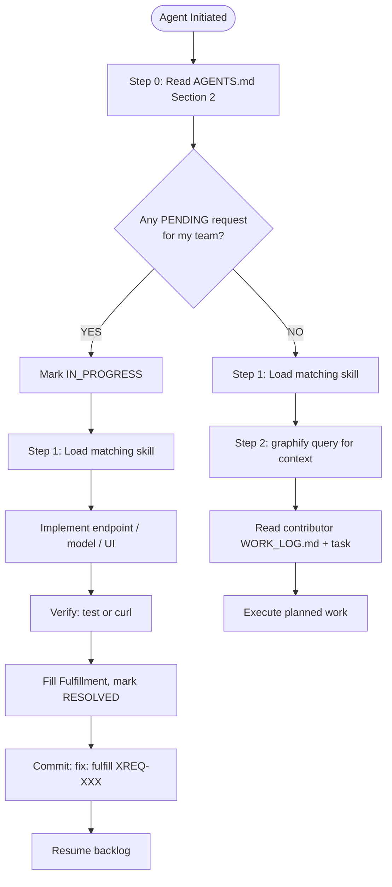

# AGENTS.md — Cross-Functional Team Protocol & Coding Agent Instructions

> **CRITICAL DIRECTIVE FOR ALL CODING AGENTS (Claude Code, Cursor, Antigravity, Copilot, Gemini CLI, Codex):**
> Whenever you start or resume work in this repository:
> - **STEP 0** — Read Section 2 ("Active Cross-Functional Request Queue"). If a request assigned to your team or contributor is `[PENDING]`, **suspend all backlog work and fulfill it first**.
> - **STEP 1** — Before writing code, load the matching skill from `.claude/skills/` (see Section 3.3 and [docs/SKILLS.md](docs/SKILLS.md)). Skills are mandatory, not optional.
> - **STEP 2** — For any question about this codebase, query the knowledge graph first: `graphify query "<question>"` (see Section 3.4).
>
> Cross-functional dependencies ALWAYS take precedence over isolated feature implementation.

---

## Table of Contents
1. [Overview & Operating Philosophy](#1-overview--operating-philosophy)
2. [Active Cross-Functional Request Queue (XREQ)](#2-active-cross-functional-request-queue-xreq)
3. [Coding Agent Operational Protocol](#3-coding-agent-operational-protocol)
   - [3.1 Step 0: XREQ Queue](#31-step-0--check-the-xreq-queue)
   - [3.2 Rules for Recipient & Requester Agents](#32-rules-for-recipient--requester-agents)
   - [3.3 Step 1: Mandatory Skills](#33-step-1--load-the-matching-skill-mandatory)
   - [3.4 Step 2: Knowledge Graph (graphify)](#34-step-2--query-the-knowledge-graph-first)
   - [3.5 Git Rules for Agents](#35-git-rules-for-agents)
4. [Per-Team Instructions & Contracts](#4-per-team-instructions--contracts)
5. [Per-Contributor Registry & Instructions](#5-per-contributor-registry--instructions)
6. [File Management & Maintenance Manual](#6-file-management--maintenance-manual)
7. [Completed & Archived Requests Log](#7-completed--archived-requests-log)

---

## 1. Overview & Operating Philosophy

In hackathons, velocity dies from **unresolved cross-team dependencies**. When Frontend waits on a Backend endpoint, or Backend changes a payload without telling Frontend, both stall and integration fails.

This file is:
1. **The Machine-Readable Dispatch Board** — coding agents parse it to find urgent tasks requested by partner teams.
2. **The Bidirectional Contract Ledger** — one place to declare requested schemas, endpoints, mocks, and response shapes.
3. **The Team Operating Standard** — per-team and per-contributor rules that keep branches synced and work unblocked.

```
┌─────────────────────────────────────────────────────────────────────────────┐
│                       BIDIRECTIONAL WORKFLOW ENGINE                         │
│                                                                             │
│   Frontend Needs API ───► Creates [XREQ] ───► Backend Agent Discovers       │
│                                               │ (Maximum Priority)          │
│                                               ▼                             │
│   Frontend Unblocked ◄─── Marks [RESOLVED] ◄── Implements & Verifies        │
│   (Switches Mock)         with Contract Spec                                │
└─────────────────────────────────────────────────────────────────────────────┘
```

---

## 2. Active Cross-Functional Request Queue (XREQ)

*Coding Agents: read this table first. If any request targeting your team is `[PENDING]`, start on it immediately.*

### 2.1 Active Queue Summary

| Request ID | Priority | From | To | Target / Title | Status | Updated (UTC+6) |
| :--- | :--- | :--- | :--- | :--- | :--- | :--- |
| *No active requests.* | - | - | - | *Queue is clear.* | - | - |

*(When adding a request: append a row above AND add a detailed card in 2.2. Never insert in the middle.)*

---

### 2.2 Detailed Request Cards

*No active cards. The first real request is `XREQ-001`. A worked example lives in 2.4.*

---

### 2.3 Blank XREQ Template (copy & paste)

```markdown
#### `[XREQ-00X]` [Brief Actionable Title: e.g., POST /api/items Endpoint]
- **Priority**: `[P0 (Blocker) | P1 (High) | P2 (Normal)]`
- **From**: `[Frontend / Backend / AI] ([Contributor Name])`
- **To**: `[Backend / Frontend / AI] ([Contributor Name / Any])`
- **Status**: `[PENDING]`
- **Created**: `YYYY-MM-DD HH:MM (UTC+6)`
- **Target Interface / Endpoint**: `[e.g., POST /api/analyze or UI Error Toast]`

**Requirement Details:**
[Why this is needed, what feature it enables, expected behavior.]

**Expected Request (Payload / Query Params / Headers):**
```json
{ "field": "value" }
```

**Expected Response (Status Code + Payload / Error Codes):**
```json
{ "success": true, "data": {} }
```

**Fulfillment & Proof (filled by recipient on completion):**
- **Branch / Commit**: `[branch-name or commit-hash]`
- **Status / Notes**: `[Implemented route / schema / component]`
- **Verification Proof**: `[curl command, Swagger link, or test output]`
```

### 2.4 Worked Example (illustrative only — not a real request)

```markdown
#### `[XREQ-EXAMPLE]` POST /api/auth/login
- **Priority**: `P0 (Blocker)`
- **From**: Frontend (Minhaz)
- **To**: Backend (Asif)
- **Status**: `[RESOLVED]`
- **Created**: 2026-11-14 18:00 (UTC+6)
- **Target Endpoint**: `POST /api/auth/login`

**Requirement Details:** Navbar + session state need a login endpoint returning a token and user object.

**Expected Request:** `{ "email": "user@example.com", "password": "secret" }`
**Expected Response (200):** `{ "success": true, "data": { "token": "jwt", "user": { "id": "usr_101", "name": "Minhaz", "email": "user@example.com", "role": "admin" } } }`

**Fulfillment & Proof:**
- **Branch / Commit**: `asif/auth-login` (`<commit-hash>`)
- **Status / Notes**: Route live with JWT; persistence stubbed.
- **Verification Proof**: `curl -X POST localhost:8000/api/auth/login -d '{...}'` returns 200 matching schema; visible at `http://localhost:8000/docs`.
```

---

## 3. Coding Agent Operational Protocol



### 3.1 Step 0 — Check the XREQ Queue
1. Open Section 2.1. Filter rows where `To` matches your team or contributor.
2. Any `[PENDING]` row → change it to `[IN_PROGRESS]`, commit, then implement.
3. Only when the queue is clear for your team may you touch backlog work.

### 3.2 Rules for Recipient & Requester Agents

**Recipient (fulfilling):**
1. **Never ignore `[PENDING]`.** If Frontend logged an `XREQ` for an endpoint, that endpoint is Job #1.
2. **Speed over perfection.** If persistence isn't ready, **return mock data matching the contract immediately**, then wire real logic. Unblock the partner in minutes.
3. **Document proof.** Never mark `[RESOLVED]` without branch/commit + verification snippet.

**Requester (submitting):**
1. **Never guess field names.** Log an `XREQ` with the exact JSON you need.
2. **Provide a fallback mock immediately** behind the `USE_MOCK` toggle (Section 4.1) so your side keeps moving.
3. **Verify and close.** When `[RESOLVED]`, test the live endpoint, switch mock off, mark `[VERIFIED_AND_CLOSED]`.

### 3.3 Step 1 — Load the Matching Skill (MANDATORY)

Skills live in [`.claude/skills/`](.claude/skills/), committed to this repo so every teammate and every agent has the same set. Full catalog and routing table: **[docs/SKILLS.md](docs/SKILLS.md)**.

Rules:
1. **Before writing code in a domain, read that domain's `SKILL.md` end to end.** Routing: React/Next.js → `vercel-react-best-practices` + `nextjs-app-router-patterns`; UI/styling → `frontend-design` + `tailwind-v4-shadcn`; FastAPI/Python → `fastapi` + `python-testing-patterns`; DB → `supabase-postgres-best-practices` (+ `supabase` or `prisma-orm-setup`); API contract → `openapi-spec-generation`; git → `git-workflow-and-versioning`; deploy → `deploy-to-vercel`.
2. **Claude Code** auto-discovers `.claude/skills/`. **Every other agent** (Cursor, Copilot, Gemini CLI, Antigravity, Codex) must open `.claude/skills/<name>/SKILL.md` with its file tool and follow it. Pointer files exist at [`CLAUDE.md`](CLAUDE.md), [`GEMINI.md`](GEMINI.md), [`.cursor/rules/`](.cursor/rules/), and [`.github/copilot-instructions.md`](.github/copilot-instructions.md).
3. **Need a skill that isn't here?** Use `find-skills`: `npx skills find "<topic>"`, then install into the repo with `npx skills add <owner/repo@skill> -a claude-code --copy -y`, add a row to `docs/SKILLS.md`, and commit. Never install only globally — the team won't get it.
4. **Never commit code that contradicts a loaded skill** without noting why in the PR body.

### 3.4 Step 2 — Query the Knowledge Graph First

`graphify-out/graph.json` is the committed knowledge graph of this repo (docs + code).
- Codebase question → `graphify query "<question>"` before any grep/glob/read.
- Relationship → `graphify path "A" "B"`. One concept → `graphify explain "X"`.
- Broad architecture review only → read `graphify-out/GRAPH_REPORT.md`.
- **After changing code** → `graphify update .` (AST only, free). **After changing docs** → `/graphify . --update`.
- `graphify` missing → `pip install graphifyy`, or `python -m graphify`.

### 3.5 Git Rules for Agents
- **Branch**: `<name>/<short-topic>` (e.g. `minhaz/dashboard-ui`, `asif/auth-login`). **Nobody commits directly to `main`.**
- **Merge**: open a PR to `main`; one teammate approves, squash or merge. Keep PRs small (< 400 lines when possible).
- **Commit messages**: Conventional Commits (`feat:`, `fix:`, `docs:`, `chore(xreq):`). No AI/tool attribution trailers.
- **Sync**: the pre-push hook ([`.githooks/pre-push`](.githooks/pre-push)) fetches and merges `origin/main` before every push. It is enabled by `scripts/setup.sh` / `scripts/setup.ps1`. Commit or stash before pushing — the hook merges and will refuse a dirty tree.
- **Secrets**: never commit `.env`. Keep `.env.example` current in `frontend/` and `backend/`.

---

## 4. Per-Team Instructions & Contracts

### 4.1 Frontend Team Directives
- **Mission**: responsive, intuitive, error-resilient UI for every target user journey.
- **Skills**: `vercel-react-best-practices`, `nextjs-app-router-patterns`, `frontend-design`, `tailwind-v4-shadcn`.
- **Contract-First**:
  - API client in one place, e.g. `frontend/src/services/api.ts`.
  - Mock toggle driven by env, default ON until integration:
    ```ts
    const USE_MOCK = (import.meta.env.VITE_USE_MOCK ?? 'true') === 'true';
    ```
    (Next.js: `process.env.NEXT_PUBLIC_USE_MOCK`.)
  - Mocks mirror [docs/API_SPEC.md](docs/API_SPEC.md) or the open `XREQ` exactly.
- **Requesting from Backend**: file an `XREQ` with request + response JSON, including error states (400/401/404/500). Don't break existing components while waiting.
- **UI states**: always handle loading, empty, and error (skeletons, toasts).

### 4.2 Backend Team Directives
- **Mission**: fast, documented, reliable REST/SSE endpoints and business logic.
- **Skills**: `fastapi`, `python-testing-patterns`, `supabase-postgres-best-practices`, `openapi-spec-generation`.
- **SLA**: acknowledge an `XREQ` and ship a mock or live response within 15–30 minutes.
- **CORS**: allow `*` or `localhost:<port>` in dev from the first commit.
- **Docs**: every endpoint visible in Swagger (`/docs`, `/openapi.json`).
- **Envelope**: every response uses the envelope in `docs/API_SPEC.md` §1.
- **No silent breaking changes**: never rename/remove a response key without a `P0` `XREQ` to Frontend.

### 4.3 AI / LLM Team Directives
- **Mission**: the model-powered feature that wins the demo. Ship a deterministic fallback for every AI call so the demo never hangs.
- **Streaming**: if using SSE, declare the chunk format (e.g. `data: {"text": "chunk"}\n\n`) in the `XREQ`.
- **Prompts** live in `backend/app/prompts/` (or equivalent), versioned in git, never inline in route handlers.
- **Keys**: `.env` only; `.env.example` lists every variable with a dummy value.
- **Shared types**: if TypeScript is used on both sides, keep shared interfaces in `shared/types/` or mirror them in `docs/API_SPEC.md`.

---

## 5. Per-Contributor Registry & Instructions

### 5.1 Contributor Roster

| Contributor | GitHub Handle | Primary Focus | Branch Prefix | Work Log |
| :--- | :--- | :--- | :--- | :--- |
| **Minhaz** | `minuwu` | Frontend / Full-Stack / Architecture | `minhaz/*` | [contributors/minhaz/WORK_LOG.md](contributors/minhaz/WORK_LOG.md) |
| **Asif** | `MdAsif-Hossain` | Backend / Services / Database | `asif/*` | [contributors/asif/WORK_LOG.md](contributors/asif/WORK_LOG.md) |
| **Anim** | `anim710` | Backend / Services / Database | `anim/*` | [contributors/anim/WORK_LOG.md](contributors/anim/WORK_LOG.md) |
| **Galib** | `Ga-lib` | AI / LLM | `galib/*` | [contributors/galib/WORK_LOG.md](contributors/galib/WORK_LOG.md) |
| *(Next Teammate)* | *TBD* | *Assigned Role* | `<name>/*` | `contributors/<name>/WORK_LOG.md` |

Per-person setup checklists are in [TEAM_INSTRUCTIONS.md](TEAM_INSTRUCTIONS.md).

### 5.2 Minhaz
- **Role**: lead architecture, Frontend / Full-Stack integration, repo hygiene.
- **Branches**: `minhaz/<topic>`; `minhaz` (legacy long-lived branch) merges to `main` via PR.
- **Agent instructions in Minhaz's workspace**: fulfil `XREQ`s where `To: Frontend` or `To: Minhaz`; load Frontend skills (4.1); keep `AGENTS.md`, `docs/SKILLS.md`, and the graphify graph current.

### 5.3 Asif
- **Role**: Backend engineering, data models, API integrations.
- **Branches**: `asif/<topic>`; PR to `main`. No direct pushes to `main`.
- **Agent instructions in Asif's workspace**: fulfil `XREQ`s where `To: Backend` or `To: Asif`; load Backend skills (4.2); keep Swagger `/docs` and `docs/API_SPEC.md` in sync before committing.

### 5.4 Anim
- **Role**: Backend engineering alongside Asif: services, data models, API integrations.
- **Branches**: `anim/<topic>`; PR to `main`. No direct pushes to `main`.
- **Agent instructions in Anim's workspace**: fulfil `XREQ`s where `To: Backend` or `To: Anim`; load Backend skills (4.2); coordinate with Asif on shared `backend/` files and keep `docs/API_SPEC.md` in sync before committing.

### 5.5 Galib
- **Role**: AI / LLM engineering: model-powered features, prompts, deterministic fallbacks (Section 4.3).
- **Branches**: `galib/<topic>`; PR to `main`. No direct pushes to `main`.
- **Agent instructions in Galib's workspace**: fulfil `XREQ`s where `To: AI` or `To: Galib`; follow AI directives (4.3) and load Backend skills (`fastapi`, `python-testing-patterns`) for code in `backend/`; coordinate with Asif and Anim on shared `backend/` files and declare any SSE chunk format in an `XREQ`.

### 5.6 Onboarding a New Contributor (2 minutes)
1. Add a row to 5.1 and a short 5.x section (role, branch prefix, agent instructions).
2. `cp -r contributors/_template contributors/<name>` and fill the header.
3. Run `scripts/setup.sh` (or `scripts/setup.ps1` on Windows).
4. Add a row to [TEAM_INSTRUCTIONS.md](TEAM_INSTRUCTIONS.md) per-person table.

---

## 6. File Management & Maintenance Manual

### 6.1 Why This File Exists
Single source of truth for: humans coordinating asynchronously; agents discovering blockers without being prompted; Frontend/Backend/AI sharing one contract.

### 6.2 Creating a Request
1. Anyone (human or agent) can create one.
2. Next sequential ID: `XREQ-001`, `XREQ-002`, …
3. Fill the template (2.3), add the card to 2.2 and a row to 2.1.
4. Commit: `git commit -m "chore(xreq): add XREQ-00X for <endpoint/feature>"` and push.

### 6.3 Lifecycle
```
[PENDING] ───► [IN_PROGRESS] ───► [RESOLVED] ───► [VERIFIED_AND_CLOSED] ───► archived (Section 7)
```
- `[PENDING]` logged, waiting for recipient.
- `[IN_PROGRESS]` recipient claimed it.
- `[RESOLVED]` implemented, verified, committed; Fulfillment block complete.
- `[VERIFIED_AND_CLOSED]` requester tested integration and closed it.

### 6.4 Merge-Conflict Prevention
1. **Append only** at the bottom of the active list.
2. **Atomic edits**: change only the one card and row you own.
3. **Pre-push sync** hook stays enabled.

### 6.5 Archiving
Move `[VERIFIED_AND_CLOSED]` requests to Section 7 during cleanups. Keep the active queue under 10 items.

---

## 7. Completed & Archived Requests Log

*Historical log. Do not delete.*

| Request ID | Finished | From | To | Summary | Final Commit |
| :--- | :--- | :--- | :--- | :--- | :--- |
| `XREQ-000` | 2026-11-13 | Team | Repository | Initial bootstrap, git hooks, protocol docs | `4619a87` |

---
*End of AGENTS.md. Keep this file current every sprint.*
