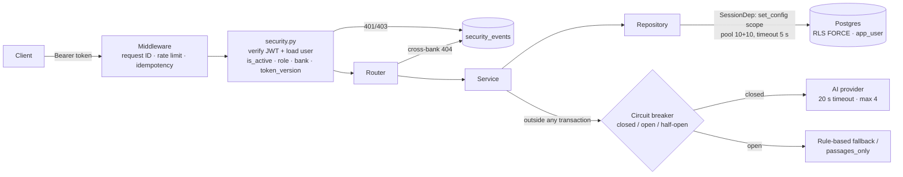
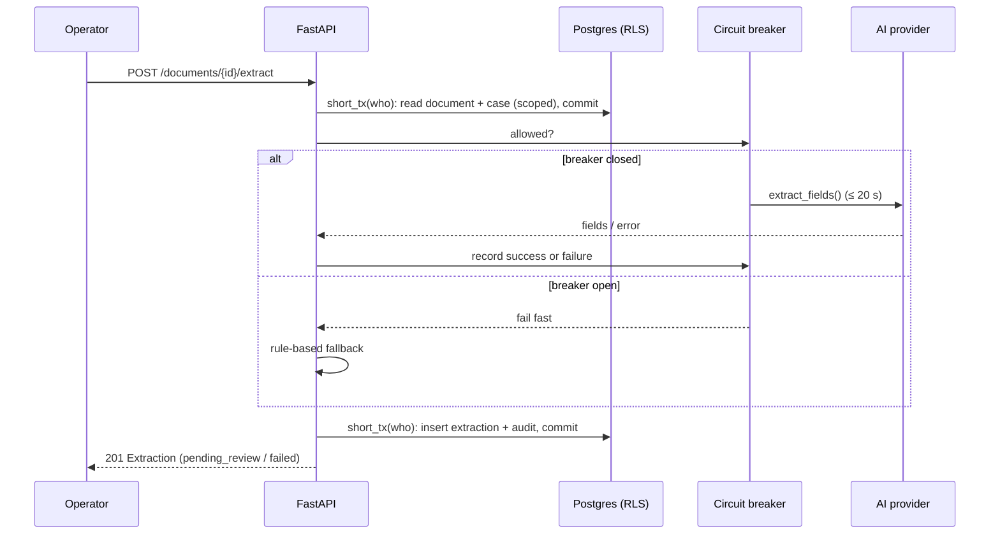

# Backend Design Review — Fraud Relief Case System

**Review date** 2026-11-14 · **Reviewer** Backend team (Asif) · **Method** `backend-design-review` skill (`.claude/skills/backend-design-review`)
**Documents reviewed:**
- [API_SPEC.md](../API_SPEC.md) v0.3.0
- [openapi.yaml](../openapi.yaml) v0.3.0
- [backend-plan.md](backend-plan.md) v0.3
- [backend-development-guide.md](backend-development-guide.md) v1.1
- [use-case diagram](../diagrams/use-cases.excalidraw)

---

## 1. Executive summary

The design is sound for a 48-hour build: a modular monolith with database-enforced bank separation, an AI that only suggests, and contract-first development. Earlier reviews have mostly been folded into guide v1.1.

What remains:
- the **documents disagree** with each other;
- the **v0.4.0 contract changes** haven't been applied;
- **resilience gaps** around the external AI provider;
- **security details** that a banking reviewer would ask about.

**Overall assessment: approved with conditions.** No new critical issue. Five high-severity items must be closed before or during Phase 0–2.

| Severity | Count |
| :--- | :--- |
| 🔴 Critical | 0 new (all earlier critical items are fixed in guide v1.1 or scheduled as contract C-items, see §4.5) |
| 🟠 High | 5 |
| 🟡 Medium | 8 |
| 🟢 Low | 6 |

---

## 2. Review scope

**Covered:**
- API design (REST, OpenAPI)
- database architecture
- architecture and integration (the AI provider, background jobs)
- security
- performance and scalability

**Not applicable:** GraphQL, gRPC, microservices, message queues. One FastAPI service and one Postgres is the right size for the brief.

**Not covered:** frontend, devops beyond the dev database, the AI prompts themselves (Galib).

**Assumptions:**
- synthetic data only;
- a 48-hour hackathon with 2 backend developers;
- free-tier hosting;
- the design should also hold up when judges ask "what would a 3-month pilot need?"

---

## 3. Key findings

### 🟠 High
1. **H1. No circuit breaker for the AI provider.** During an outage, every extraction and chat waits the full 20 s before falling back.
2. **H2. The plan and the guide disagree in five places.** Anyone following the plan builds the wrong thing.
3. **H3. Contract v0.4.0 isn't applied**, while the frontend builds against v0.3.0 on `main`.
4. **H4. Staff tokens can't be revoked, and their role and bank can go stale** for up to 8 hours.
5. **H5. D2 (operators see all banks) is still only "Proposed".** It's the judges' first question.

### Findings by area

| Area | 🟠 | 🟡 | 🟢 |
| :--- | :--- | :--- | :--- |
| API design | 1 (H3) | 1 (M1) | 3 (L1, L4, L5) |
| Database | 1 (H2) | 3 (M4, M7, M8) | 2 (L2, L3) |
| Architecture / integration | 1 (H1) | — | 1 (L6) |
| Security | 2 (H4, H5) | 4 (M2, M3, M5, M6) | — |

---

## 4. Detailed findings

### 4.1 High

**H1. No circuit breaker for the AI provider** · Architecture / Resilience · effort S · owner Asif (A8)
- **Current:** each call has a 20 s timeout and at most 4 run at once (guide §4.4 rule 10). There is no memory of past failures.
- **Impact:**
  - During a provider outage, every extraction and chat waits 20 s before the fallback.
  - The concurrency cap fills up, so later calls fall back immediately even after the provider recovers.
  - A live demo hit by an outage looks frozen.
- **Recommendation:** a simple circuit breaker in `services/extraction.py` and `services/retrieval.py`:
  - **closed → open** after 3 consecutive failures or timeouts;
  - **open for 60 s:** every call falls back at once, and `/api/health` reports `ai: unavailable` / `rag: degraded`;
  - **half-open:** one trial call decides whether it closes again;
  - no retries inside a request (they only double the wait); at most 1 retry, with jitter, for background indexing.
- **Test:** 3 mocked timeouts, then the next call returns the fallback in under 100 ms.

**H2. The plan and the guide disagree** · Database / Documentation · effort S · owner Asif (Phase 0)

| Topic | backend-plan.md says | Guide v1.1 says (correct) |
| :--- | :--- | :--- |
| Database users | one `DATABASE_URL` (`app_user`); compose runs `alembic` and the seed as `app_user` (§7) | `migrator` for migrations and seed, `app_user` for the app |
| Enums | "Postgres enum types" (§4) | `text` + `CHECK` |
| Vector index | "HNSW on `embedding`" (§4) | no HNSW below ~1,000 passages |
| File storage | `documents.content bytea` (§4, D10) | a separate `document_contents` table |
| Edit conflicts | D12: send `updated_at` | integer `version`, atomic `UPDATE … WHERE version` |

- **Impact:** coding agents read the plan, so the conflicting instructions produce conflicting code.
- **Recommendation:** update backend-plan §4, §7 and D10/D12 to match the guide, in the same PR as contract v0.4.0. Add one line to the plan: "Where this plan and the guide disagree, the guide wins."

**H3. Contract v0.4.0 isn't applied** · API design · effort M · owner Asif (P0.1)
- **Current:** `main` has v0.3.0. C1–C4, C7 and C12 (edit rules, duplicate protection, `version`, closed cases, deadlines, money as numbers) exist only in the guide.
- **Impact:** the frontend builds forms and mocks without `version`/`expected_version` and without the new error codes, so integration breaks later.
- **Recommendation:** apply v0.4.0 now through a PR approved by Minhaz, and file a P1 `XREQ` to the frontend listing the new fields.

**H4. Staff tokens can't be revoked; their claims go stale** · Security · effort S · owner Anim (N3)
- **Current:** the JWT holds the role and bank for 8 hours, and verification only checks the signature, expiry, issuer and audience.
- **Impact:**
  - A disabled user, or a bank viewer moved to another bank, keeps their old access for up to 8 hours.
  - A stolen token can't be cut off.
- **Recommendation:**
  - On every request, load `users.is_active, role, bank_id, token_version` by primary key (one indexed read).
  - Reject the token if the user is inactive or its `token_version` claim doesn't match.
  - Take role and bank **from the database**, not from the token.
  - Add `users.is_active` and `users.token_version` to migration 001.

**H5. D2 is still "Proposed"** · Security / Authorization · effort S (a decision) · owner team (Minhaz and Asif)
- **Current:** operators and supervisors see all five banks; the plan marks this "Proposed".
- **Impact:** "How do you stop Bank A seeing Bank B?" is judge question 1. An undecided answer costs points, and changing it after coding means rewriting the database rules.
- **Recommendation:** decide in Phase 0.
  - Either keep D2, and prepare the justification: shared operations center, every case view audited, plus M3.
  - Or switch to least privilege: an `operator_banks` assignment table, where an operator's scope is a *list* of banks (`app.bank_ids`). This costs about 1 hour if done before migration 002.

### 4.2 Medium

**M1. No version in the API path** · API design · effort S · owner Asif (P0.1)
- Paths are `/api/...`. Moving to `/api/v1/...` now is free; later it's a breaking change for every client.
- Alternatively, record the decision in the contract: "no versioning in the hackathon; breaking changes only through an `XREQ`".

**M2. The access-code hash algorithm isn't specified** · Security · effort S · owner Asif (A4)
- **Problem:** a code has 60 bits of entropy. A fast unsalted SHA-256 of it can be brute-forced offline if the database leaks.
- **Fix:** use `HMAC-SHA256(server_pepper, normalized_code)`. Lookup stays fast because it's keyed by reference, the pepper lives in env only, and comparison is constant-time. Write this into backend-plan §5.8.

**M3. Denied access isn't recorded** · Security / Monitoring · effort S · owner Asif (Phase 3)
- **Problem:** a bank viewer probing other banks' case IDs only produces 404s, and nobody sees it.
- **Fix:** log every 401, 403 and cross-bank 404 to a `security_events` table: actor, route, target ID, IP. Show a "denied requests (24 h)" count on the supervisor dashboard. This gives a strong answer to judge question 1 and detects insider probing.

**M4. Connection pool vs. thread pool sizing** · Performance · effort S · owner Asif (A3)
- **Problem:** FastAPI's thread pool runs up to about 40 requests at once, but the default SQLAlchemy pool is 5 + 10.
- **Fix:**
  - set `pool_size=10, max_overflow=10, pool_timeout=5`;
  - turn a pool timeout into `503 SERVICE_BUSY` instead of hanging;
  - write the numbers into the guide.

**M5. Database TLS isn't required** · Security · effort S · owner Asif (P0.5 / devops)
- **Problem:** hosted Postgres over the internet without `sslmode=require` sends personal data and passwords in clear text.
- **Fix:** require `sslmode=require` (`verify-full` where the host provides a CA) in every non-local URL. The app refuses to start without it outside `dev`.

**M6. Staff log in with a password only** · Security · effort M · owner Anim (pilot)
- **Problem:** supervisors approve payouts and see all banks. Banking reviewers expect multi-factor login.
- **Fix:** for the hackathon, list it as a known limit. For a pilot, add TOTP for supervisors and operators, a password policy, and lockout with backoff.

**M7. The audit log keeps personal data forever** · Data protection · effort M · owner Asif (pilot)
- **Problem:** `audit_log.changes` stores old and new phone, email and address, and the log is immutable. That conflicts with retention and erasure duties.
- **Fix:**
  - store contact fields in `changes` as `"[changed]"` plus a keyed hash, not the plaintext;
  - define retention (for example, cases closed more than N years ago are anonymised);
  - document both in the plan.

**M8. No victim entity** · Database · effort M · owner Anim (C6) with Asif (index)
- **Problem:** duplicate detection (C6) and "this victim's other cases" rely on string matching across case rows.
- **Fix:**
  - add normalised columns `victim_phone_norm` and `victim_email_norm` (lower-cased, digits only), indexed;
  - match duplicates on `(bank_id, norm contact, amount, transfer_date)`;
  - a separate `victims` table can wait for the pilot.

### 4.3 Low

| ID | Finding | Fix | Owner |
| :--- | :--- | :--- | :--- |
| L1 | `429 RATE_LIMITED` has no `Retry-After` header | Send `Retry-After: <seconds>` and document it in the contract | Anim (N4) |
| L2 | The audit log uses offset pagination, which gets slow as the log grows | Keyset pagination (`?before=<at>,<id>`) for `/api/audit-logs` | Asif (later) |
| L3 | Search `q` (reference, victim name, account) uses unindexed `ILIKE` | A `pg_trgm` GIN index on those three columns | Asif (Phase 3) |
| L4 | OpenAPI lint warnings, and no `500` response documented | A shared `InternalError` response on every operation; a short Redocly config for intentional warnings | Asif (P0.1) |
| L5 | Public `/api/health` reveals `db`/`ai`/`rag` state | Public `/api/health` returns `status` only; `/api/health/details` for staff | Anim (later) |
| L6 | Untrusted PDFs and images are parsed in the API process | Page and pixel limits, a parse timeout, no external entity loading; check this in Galib's extractor | Galib + Asif (Phase 2) |

### 4.4 Positive observations

1. **Separation is enforced in depth:**
   - token scope + RLS with `FORCE` + a non-owner `app_user` + repository filters;
   - another bank's record returns 404, not 403;
   - tests run as `app_user`.

   This is the strongest possible answer to judge question 1.
2. **The AI only suggests:** a separate `ai_extractions` table, a human accept step, AI value vs final value in the audit log, and fallbacks that never fail the request.
3. **Contract-first:** API_SPEC + OpenAPI 3.1 lint-checked, a working mock for the frontend, and a planned Prism proxy check against the real backend.
4. **The audit log is append-only and written in the same transaction** as each change.
5. **The chatbot is minimal by design:** bank scope taken from the case, an allow-listed context, no tools, and escalation to staff.
6. **Professional write path (guide v1.1):** commit before the response, an atomic version check, scoped duplicate protection, short transactions around AI calls.
7. **Clear ownership and gates:** one migration owner, file ownership, and the hour-14 and hour-24 gates.

### 4.5 Earlier findings: where they stand

| Finding (earlier reviews) | Status |
| :--- | :--- |
| Two DB users; background jobs without scope; DB transaction held during AI calls; tests run as superuser | ✅ In guide v1.1 (§4.3, §6, §7) |
| Commit before response; atomic edit conflicts; scoped duplicate protection; explicit test DB | ✅ In guide v1.1 |
| N+1 in lists; blob in `documents`; HNSW + filter; enum types; `SECURITY DEFINER` search path; weak JWT secret; log redaction | ✅ In guide v1.1 (§4.4, §6) · plan not yet updated (H2) |
| Edit rules, `version`, closed cases, deadlines, money as numbers | ⏳ Contract C1, C3, C4, C7, C12 (H3) |
| Payout amount, duplicate flag, download headers, deduplicated view audit | ⏳ C5, C6, C10, C11 (Phases 2–3) |
| Bluebook audience, access-code delivery, contact-change alerts | ⏳ C8, C9 (Phase 4) |
| Push to `main` without a PR | ⏳ Retroactive review by Minhaz and Anim (work log, session 7) |

---

## 5. Architecture diagrams

### Request path with the recommended additions (H1, H4, M3, M4)

### Extraction with short transactions and the breaker

---

## 6. Action items

| ID | Issue | Sev | Action | Owner | When | Status |
| :--- | :--- | :--- | :--- | :--- | :--- | :--- |
| 1 | H3 | 🟠 | Contract v0.4.0 via PR + `XREQ` to the frontend | Asif | P0.1 | Not started |
| 2 | H2 | 🟠 | Align backend-plan with guide v1.1 (same PR) | Asif | P0.1 | Not started |
| 3 | H5 | 🟠 | Decide D2; if least privilege, add `operator_banks` before migration 002 | Team | Phase 0 | Not started |
| 4 | M1 | 🟡 | Decide `/api/v1` or document "no versioning" (same PR) | Asif | P0.1 | Not started |
| 5 | L4 | 🟢 | Shared 500 response + Redocly config (same PR) | Asif | P0.1 | Not started |
| 6 | H4 | 🟠 | Per-request user load; `is_active` + `token_version` in migration 001 | Anim / Asif | Phase 1 | Not started |
| 7 | M2 | 🟡 | HMAC-SHA256 + pepper for access codes | Asif | Phase 1 | Not started |
| 8 | M4 | 🟡 | Pool sizing + `503 SERVICE_BUSY` | Asif | Phase 1 | Not started |
| 9 | L1 | 🟢 | `Retry-After` on 429 | Anim | Phase 1 | Not started |
| 10 | H1 | 🟠 | Circuit breaker + test | Asif | Phase 2 | Not started |
| 11 | L6 | 🟢 | Limits on parsing untrusted files | Galib + Asif | Phase 2 | Not started |
| 12 | M3 | 🟡 | `security_events` + dashboard count | Asif | Phase 3 | Not started |
| 13 | M8 | 🟡 | Normalised contact columns + index (for C6) | Anim + Asif | Phase 3 | Not started |
| 14 | L3 | 🟢 | `pg_trgm` index for `q` | Asif | Phase 3 | Not started |
| 15 | M5 | 🟡 | `sslmode=require` outside dev | Asif | Devops | Not started |
| 16 | M6, M7, L2, L5 | 🟡/🟢 | Write them up as known limits and pilot work in the README | Asif | Hour 44 | Not started |

## 7. Next steps

- **Now (Phase 0):** items 1–5 in **one PR** (contract v0.4.0 + plan alignment + versioning decision), approved by Minhaz; the D2 decision.
- **Phase 1–2:** items 6–11, folded into tasks A3, A4, A8, N3 and N4 of the guide.
- **Phase 3:** items 12–14, before the hour-24 gate.
- **Follow-up review:** at the hour-24 gate, against running code, with the same skill.
  - Focus: H1 (breaker test), H4, M3.
  - Success criteria: the RLS, permission, concurrency and AI-failure tests are green, and the contract check is clean.
