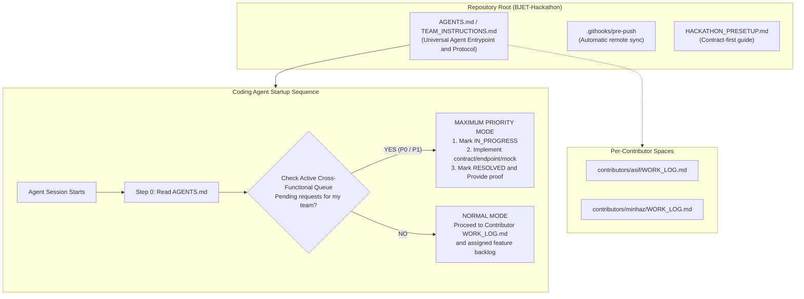

# Cross-Functional Team & Coding Agent Protocol Plan

## 1. Executive Summary & Objective

In fast-paced, multi-contributor environments (such as hackathons and agile sprints), the primary bottleneck is cross-team dependency resolution. When the **Frontend** needs an endpoint, payload adjustment, or mock structure from the **Backend** (or vice versa), progress stalls unless the request is immediately surfaced, prioritized, and resolved.

This protocol creates a **machine-readable and human-friendly operating system** for the repository that:
1. Gives coding agents (Antigravity, Cursor, Claude Code, Copilot) an **unbreakable "Step 0" directive** to scan and resolve pending cross-team dependencies with **Maximum Priority** before touching feature backlogs.
2. Provides a standardized **Cross-Functional Request Queue (`XREQ`)** with structured request/response JSON contracts, SLAs, and lifecycle states.
3. Defines explicit **Per-Team Instructions** (Frontend, Backend, BaaS/AI) and **Per-Contributor Directories** (Minhaz, Asif, etc.) for zero-friction handoffs.
4. Houses complete **Self-Management Documentation** directly within the file itself, detailing how to create, manage, resolve, verify, and archive requests without git merge conflicts.

---

## 2. Architecture & File Strategy



### Chosen Primary File: `AGENTS.md`
- **Why `AGENTS.md`**: It is the industry standard root instruction file universally parsed by coding agents (Antigravity, Cursor, Claude Code, Gemini CLI, Copilot Workspace).
- **Secondary Alias**: `TEAM_INSTRUCTIONS.md` links directly to `AGENTS.md` so humans and documentation links navigate interchangeably.

---

## 3. Protocol Components to Implement

### Component A: Coding Agent Operational Directives ("The Step 0 Rule")
- Mandatory startup routine for any AI agent executing in the repository.
- Rule: **Cross-Functional Dependencies Overrule General Feature Tasks**. If an incoming `XREQ` is pending for the agent's team, the agent must not scaffold unrelated UI or write unrelated backend routes until the blocker is resolved.

### Component B: Cross-Functional Request Queue (`XREQ`)
- **Queue Location**: A dedicated, prominent section at the top of the file for immediate parsing.
- **Status Lifecycle**:
  ```mermaid
  stateDiagram-v2
      [*] --> PENDING: Requester creates XREQ with payload contract
      PENDING --> IN_PROGRESS: Recipient agent/dev claims request
      IN_PROGRESS --> RESOLVED: Recipient implements & documents proof/commit
      RESOLVED --> VERIFIED_AND_CLOSED: Requester validates in UI or mock toggle
      VERIFIED_AND_CLOSED --> ARCHIVED: Moved to historical log
  ```
- **Standardized Schema**:
  - Request ID (`XREQ-XXX`)
  - Timestamp (UTC+6 / Bangladesh Time)
  - From & To (Team + Contributor)
  - Priority (`P0 - Blocker`, `P1 - High`, `P2 - Normal`)
  - Target Endpoint / Interface / Asset
  - Exact Request Specification (Method, Headers, Body Schema)
  - Expected Response Specification (Status Code, JSON Schema, Error Payloads)
  - Fulfillment Section (Branch/Commit, Swagger test link, live/mock notes)

### Component C: Per-Team Guidelines
1. **Frontend Team**:
   - Contract adherence: Consume endpoints strictly according to the agreed `XREQ` or `docs/API_SPEC.md`.
   - Mock-First rule: Implement UI with `USE_MOCK = true` immediately so backend work never delays styling or user journeys.
   - Request generation: When needing a new API or field, file an `XREQ` before attempting complex workarounds.
2. **Backend Team**:
   - Maximum Priority Response: When an `XREQ` is logged, write the Pydantic/dataclass schema and return mock/live responses immediately.
   - CORS & Docs: Ensure CORS is enabled and OpenAPI/Swagger documentation (`/docs`) reflects the contract.
   - Breaking Change Protocol: Never alter an existing response field without posting an `XREQ` to Frontend.

### Component D: Per-Contributor Instructions
- Individual contributor registry:
  - **Minhaz** (`minuwu`): Active role, workspace root, work log location (`contributors/minhaz/WORK_LOG.md`).
  - **Asif** (`MdAsif-Hossain`): Active role, workspace root, work log location (`contributors/asif/WORK_LOG.md`).
  - **Onboarding Template**: Format for adding new contributors in under 2 minutes.

### Component E: The Management & Maintenance Manual (In-File)
Detailed sections explaining:
- How humans add requests via standard markdown snippets.
- How agents parse, claim, and update requests programmatically.
- How to avoid git merge conflicts (sequential IDs, appending at bottom of active section, pre-push sync integration).
- Archiving procedures to keep the active queue lean and fast to read.
