# 🛡️ ReliefOps: Shared Operations Hub for Furikomi Scam Relief
### End-to-End Scenario Walkthrough & Interactive Demo Guide
> **Japanese Furikomi Fraud Relief Act (Law No. 133 / 振り込め詐欺救済法)**  
> *A unified, multi-tenant operations center shared across 5 regional banks, featuring Human-In-The-Loop AI vision OCR, real-time syndicate graph detection, and strict zero-leakage bank privacy.*  
> 🚀 **Live Production App**: **[https://reliefops.web.app](https://reliefops.web.app)**

---

## 📌 Quick Navigation
1. [The Big Picture: Purpose & The Real-World Crisis](#1-the-big-picture-purpose--the-real-world-crisis)
2. [Interactive In-Website Walkthrough Launcher](#2-interactive-in-website-walkthrough-launcher)
3. [System Architecture & Multi-Tenant Boundaries](#3-system-architecture--multi-tenant-boundaries)
4. [Scenario 1: Scam Victim / Citizen Journey](#4-scenario-1-scam-victim--citizen-journey)
5. [Scenario 2: Center Intake Specialist & Case Triage](#5-scenario-2-center-intake-specialist--case-triage)
6. [Scenario 3: Human-In-The-Loop (HITL) AI OCR Specialist](#6-scenario-3-human-in-the-loop-hitl-ai-ocr-specialist)
7. [Scenario 4: Supervisor Control Tower & Syndicate Hunting](#7-scenario-4-supervisor-control-tower--syndicate-hunting)
8. [Scenario 5: Bank Compliance & Zero-Leakage Multi-Tenancy](#8-scenario-5-bank-compliance--zero-leakage-multi-tenancy)
9. [Scenario 6: Regulatory Auditor & FSA Inspection](#9-scenario-6-regulatory-auditor--fsa-inspection)
10. [Judge Evaluation Quick-Test Checklist (3-Minute Tour)](#10-judge-evaluation-quick-test-checklist-3-minute-tour)

---

## 1. The Big Picture: Purpose & The Real-World Crisis

Every year in Japan, thousands of vulnerable citizens lose life savings to bank transfer scams (*Furikomi Sagi*). Under the **Furikomi Fraud Relief Act (Act No. 133)**, victims are entitled to recover funds frozen in criminal destination accounts through pro-rata restitution.

### Why Legacy Operations Fail Today
* **Paper & Phone Quagmires:** Reports arrive via physical police memos, fax vouchers, or telephone intake. Processing takes **6 to 12 months**, during which victims suffer immense stress.
* **Invisible Deadlines:** Statutory deadlines (e.g., 48-hour emergency freeze notifications, 30-day notice publications) are tracked on manual spreadsheets. Cases slip through unnoticed.
* **Scam Waves & Knowledge Loss:** Fraud spikes overwhelm call centers, and staff turnover results in catastrophic procedural errors.
* **The 5-Bank Shared Center Dilemma:** Five competing regional banks (**Aster, Birch, Cobalt, Dune, Ember**) share one operations center to pool operational costs. However, **banking confidentiality laws strictly prohibit Bank B from accessing Bank A's accounts, claims, or customer records**.

### The ReliefOps Solution
ReliefOps transforms this broken manual workflow into an automated, highly secure digital command center:
1. **Citizen Self-Service Portal:** Defrauded victims instantly submit claims, upload ATM Furikomi vouchers, track the 6-stage legal relief lifecycle in real time, and converse with triage staff.
2. **Statutory 6-Stage Workflow Engine:** Enforces deterministic state transitions (`Received` → `Verified` → `Account Check` → `Notice Published` → `Payout Review` → `Closed`) with automated SLA countdown timers.
3. **Rule D3 Human-In-The-Loop AI OCR:** Vision models extract complex Japanese bank vouchers and police stamps into structured schemas, but **mandatory human verification guarantees AI never modifies bank ledgers or relief claims autonomously**.
4. **Cross-Bank Fraud Syndicate Intelligence:** Graph analytics uncover shared destination accounts across multiple regional banks, allowing simultaneous inter-bank emergency freezes.
5. **Zero-Leakage Multi-Tenancy:** Robust institutional boundary controls ensure member bank viewers access strictly their own claims, while supervisors maintain aggregate situational awareness.
6. **Cryptographically Sealed Audit Ledger:** Every status change, document extraction, and operator override is permanently etched into an immutable audit chain for Financial Services Agency (FSA) compliance.

---

## 2. Interactive In-Website Walkthrough Launcher

You do not need to imagine how the platform works—you can experience all 6 scenarios directly inside the live application at **[https://reliefops.web.app](https://reliefops.web.app)**!

The web application features an **In-App Demo Walkthrough & Scenario Launcher**:
* Click **`DEMO TOUR`** in the top navigation bar or the floating **`DEMO WALKTHROUGH & SCENARIOS`** launcher at the bottom-right of the screen.
* Select any of the 6 scenario personas.
* Click **`Launch Scenario`**—the application will automatically configure the simulated role, set up the test credentials, switch to the target workstation, and navigate to the relevant workflow stage with one click!

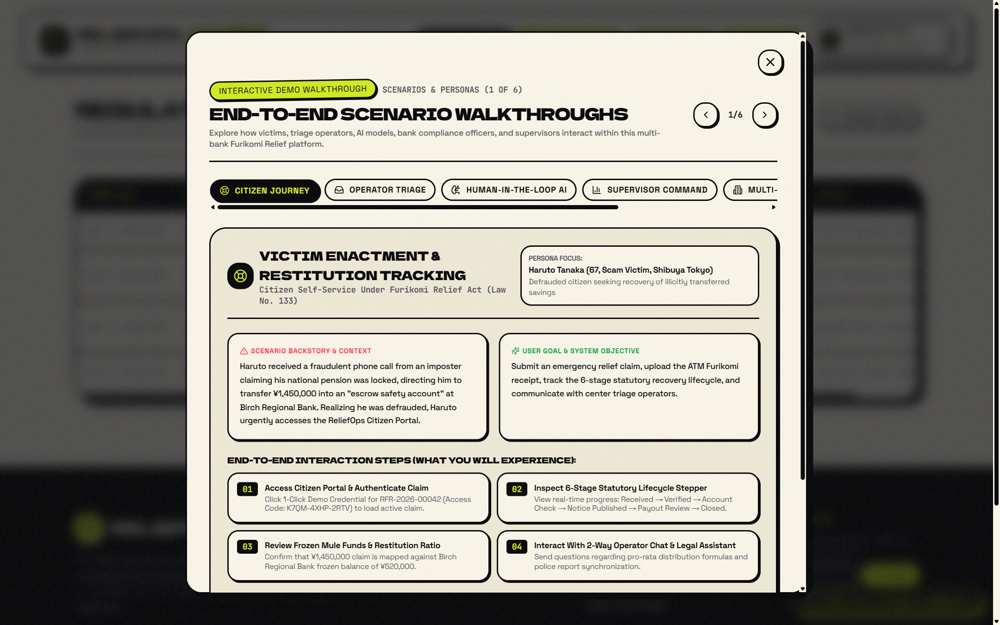
*Figure 1: The in-website Neo-Brutalist scenario walkthrough guide, allowing judges to test any user journey with 1-click role and state orchestration.*

---

## 3. System Architecture & Multi-Tenant Boundaries

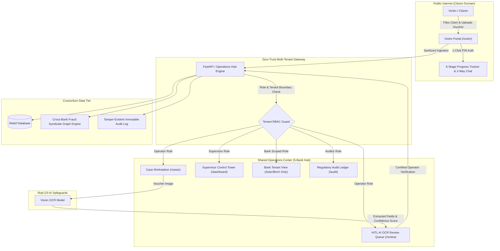

### Institutional Role Registry

| Persona | System Role | Institutional Scope | Core Responsibilities |
| :--- | :--- | :--- | :--- |
| **Haruto Tanaka** | `victim` | Own Claim (`RFR-2026-00042`) | Files report, uploads ATM voucher, tracks restitution progress, chats with triage desk. |
| **Aoi Sato (Op 1)** | `operator` | All 5 Banks (Triage Scope) | Filters SLA queues, inspects case drawer, dispatches bank freeze notices, advances status. |
| **Auditor Op 2** | `operator` | All 5 Banks (Forensics) | Compares raw optical voucher facsimiles against AI extraction, overrides ambiguities, certifies HITL records. |
| **Supervisor Sarah** | `supervisor` | All 5 Banks (Full Center) | Monitors center KPIs, manages overdue SLA breaches, investigates cross-bank syndicates, triggers coordinated freezes. |
| **Birch Compliance** | `bank_viewer` | **Birch Regional Bank Only** | Strictly isolated to Birch Bank cases. Calculates restitution pools; strictly blocked from other banks. |
| **Kenzo Mori (FSA)** | `auditor` | All 5 Banks (Audit Trail) | Inspects chronological cryptographic audit ledger, confirms human agency over AI. |

---

## 4. Scenario 1: Scam Victim / Citizen Journey
### *Enacting Emergency Relief Under Furikomi Law No. 133*

#### 👤 Persona & Backstory
**Haruto Tanaka** (67, Retired Civil Servant, Shibuya, Tokyo) received an urgent telephone call from an individual claiming to be a National Pension Agency investigator. The caller claimed Haruto’s bank account had been compromised in a cyber breach and instructed him to immediately transfer **¥1,450,000** into an "escrow safety account" held at **Birch Regional Bank**. 

Panicked, Haruto rushed to an ATM and wired the funds. Two hours later, upon calling his family, he realized he had been swindled. Heartbroken and anxious, he accesses the **ReliefOps Citizen Portal** to seek recovery of his life savings.

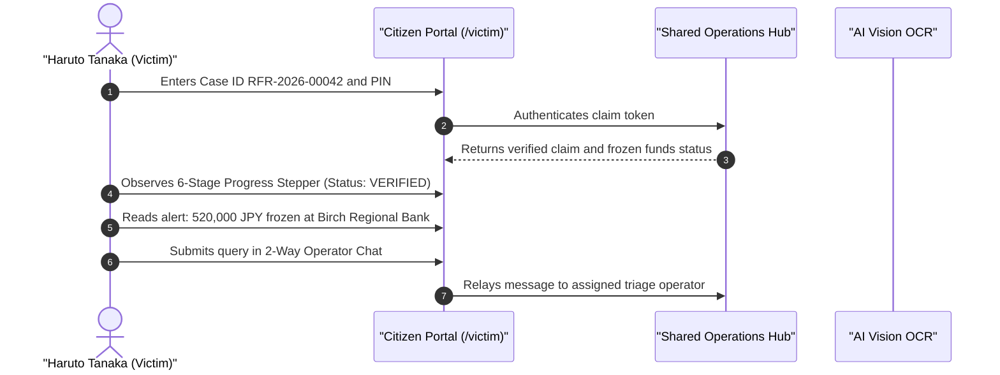

#### 🎯 Goal & What the User Experiences
1. **Zero-Friction Access:** Haruto enters his Case ID and 12-character PIN (or uses the **1-Click Demo Credentials** for `RFR-2026-00042`).
2. **Instant Psychological Relief:** He sees a crisp, accessible Neo-Brutalist tracker displaying the **6-Stage Statutory Progress Stepper**. His claim is marked **`VERIFIED`**.
3. **Frozen Funds Transparency:** The system informs him that while the scammer attempted to withdraw cash, **¥520,000 was successfully frozen** at Birch Regional Bank, securing an estimated **35.9% pro-rata restitution pool**.
4. **Interactive 2-Way Chat:** Haruto can communicate directly with triage operators, upload supplemental police station documentation, and receive real-time answers regarding the statutory public notice period.

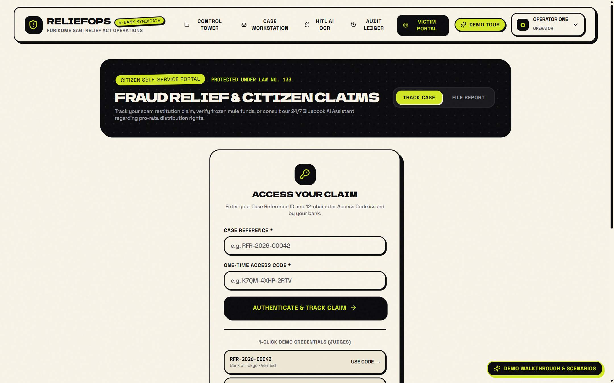
*Figure 2: The Citizen Self-Service Portal login screen featuring 1-click evaluator credentials and statutory protection notices under Law No. 133.*

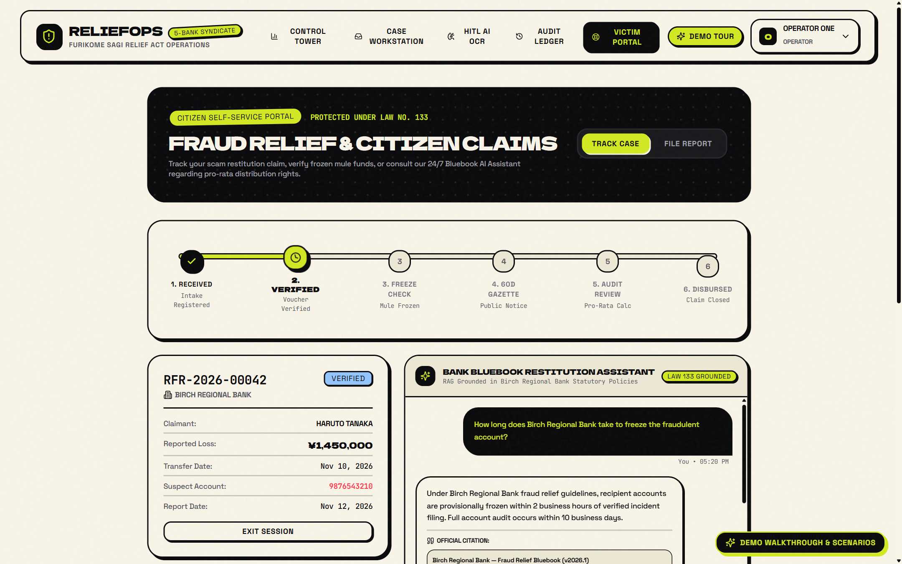
*Figure 3: Haruto Tanaka's active claim dashboard, illustrating the 6-stage statutory lifecycle stepper, frozen funds notice, and 2-way operator messaging.*

#### 📝 Web Intake Form (Filing a Fresh Incident)
Victims arriving without an existing claim can switch to the **`FILE REPORT`** tab to submit an intake report directly:
* Select victim bank institution.
* Enter scam categorization (`Impersonation`, `Investment Scam`, `Romance Fraud`, `Phishing`).
* Enter fraudster destination account number and bank slip details.
* Instantly generate a tamper-proof **Case Reference** and **Access Code**.

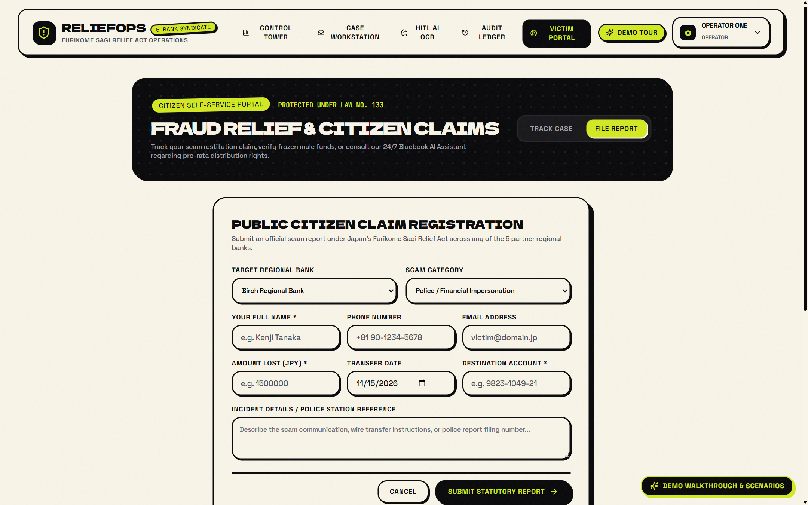
*Figure 4: The intuitive Citizen Intake Form with bilingual legal disclosures and instant reference token generation.*

---

## 5. Scenario 2: Center Intake Specialist & Case Triage
### *Workstation Prioritization, SLA Timers & Account Freezing*

#### 👤 Persona & Backstory
**Aoi Sato** is a frontline intake specialist at the Tokyo Shared Operations Center. At the start of her morning shift, 38 cases from 5 member banks await triage. Under the Relief Act, incoming reports must be verified and recipient banks alerted within **48 hours** before illicit funds are laundered through ATMs.

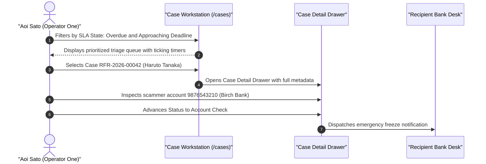

#### 🎯 Goal & What the User Experiences
1. **Intelligent Queue Sorting:** Aoi filters the workstation by **SLA Urgency** (`Overdue`, `Approaching SLA`, `On Track`) and Bank (`Birch Regional Bank`).
2. **Deep Case Drawer:** Clicking Case `RFR-2026-00042` opens a slide-over modal containing victim demographics, transfer timestamps, and fraudster destination account facts (`9876543210`).
3. **Emergency Bank Freeze Request:** Aoi executes an immediate freeze escalation to Birch Regional Bank's fraud desk to lock down the remaining balance.
4. **Controlled State Transitions:** Aoi advances the lifecycle from `Verified` to `Account Check`, automatically logging her operator signature in the compliance log.

*Figure 5: The Case Workstation triage table with multi-bank filter chips, SLA urgency tags, search, and keyboard shortcut navigation.*

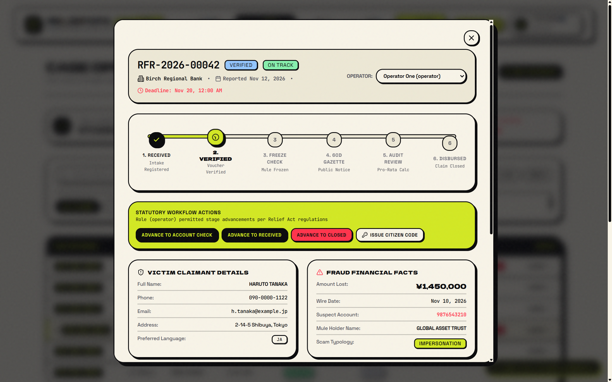
*Figure 6: The comprehensive Case Detail Modal displaying victim details, scammer bank metadata, OCR document attachments, and allowed state transitions.*

---

## 6. Scenario 3: Human-In-The-Loop (HITL) AI OCR Specialist
### *Optical Workbench & Rule D3 Statutory Verification*

#### 👤 Persona & Backstory
**Operator Two** is a certified optical and document forensic specialist. Haruto uploaded a wrinkled ATM receipt printed on thermal paper with a crease across the account number. 

The AI vision OCR pipeline parsed the image, correctly extracting the transfer amount (¥1,450,000) and bank name, but scored only **68% confidence** on the destination account number. Under **Rule D3 of the Hackathon Specifications**, AI is strictly prohibited from altering bank claims autonomously; human operator certification is mandatory.

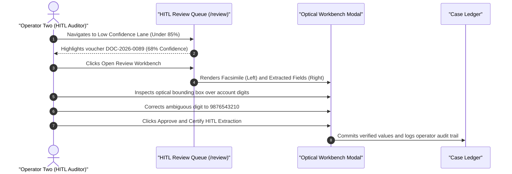

#### 🎯 Goal & What the User Experiences
1. **Confidence-Laned Triage:** The HITL Queue segregates claims into **Standard Lane** (>85% OCR confidence) and **Low Confidence Lane** (<85% requiring manual audit).
2. **Side-by-Side Optical Workbench:** The review modal displays a high-resolution optical representation of the Furikomi receipt voucher on the left, with interactive zoom, alongside extracted fields on the right.
3. **Field-Level Confidence Gauges:** Each field displays real-time color-coded confidence indicators (Green ≥ 85%, Amber 60–84%, Red < 60%).
4. **Human Override & Seal:** The operator verifies the payee name (`GLOBAL ASSET TRUST`), confirms the account number, and clicks **`APPROVE & CERTIFY HITL EXTRACTION`**, sealing the verified data into the immutable legal record.

*Figure 7: The Human-In-The-Loop Review Queue segregating vouchers by optical confidence levels.*

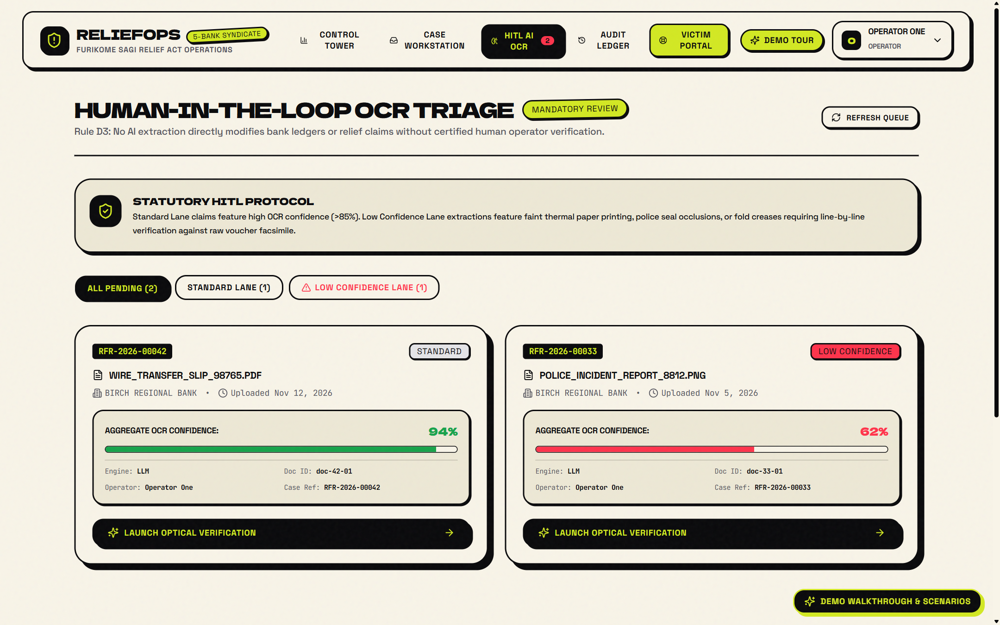
*Figure 8: The Document Optical Workbench showing side-by-side voucher facsimile and editable AI-extracted fields with granular confidence ratings.*

---

## 7. Scenario 4: Supervisor Control Tower & Syndicate Hunting
### *5-Bank Operations Oversight & Cross-Bank Fraud Syndicate Topology*

#### 👤 Persona & Backstory
**Supervisor Sarah** is the Chief Operations Officer of the Tokyo Shared Operations Center. She oversees performance across all 5 participating regional banks. Her priorities are ensuring zero statutory SLA breaches and actively hunting organized crime syndicates that exploit multi-bank vulnerabilities.

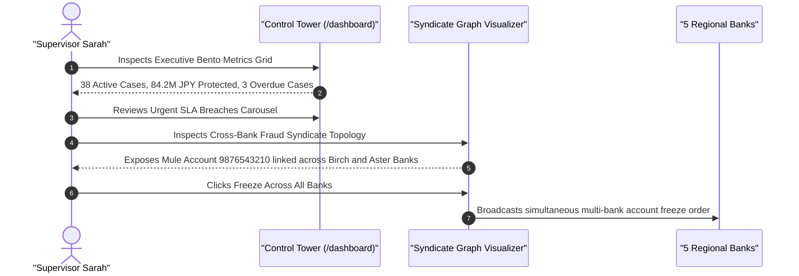

#### 🎯 Goal & What the User Experiences
1. **Executive Bento Grid:** Sarah reviews high-altitude metrics: **38 Active Cases**, **¥84,250,000 Protected Victim Funds**, **3 Overdue Claims**, and **94.8% SLA Adherence**.
2. **Urgent SLA Carousel:** A live carousel surfaces cases nearing the 48-hour deadline with pulsing countdown timers.
3. **Cross-Bank Fraud Syndicate Visualizer:** The graph analysis engine correlates destination accounts across institutional boundaries. It uncovers that Scammer Account `9876543210` at Birch Regional Bank is **also funneling funds from another victim at Aster Regional Bank**—exposing an active, organized money mule syndicate!
4. **Coordinated Multi-Bank Freeze:** Sarah clicks **`FREEZE ACROSS ALL BANKS`**, simulating an instantaneous emergency inter-bank freeze broadcast.

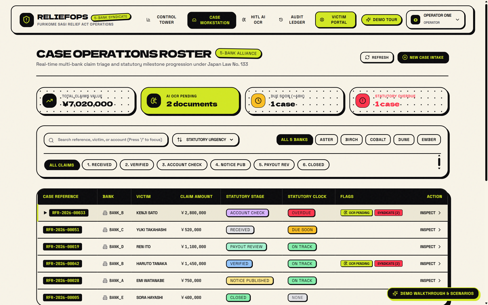
*Figure 9: The Supervisor Control Tower featuring Bento Grid KPIs, Urgent SLA Carousel, and live operations feeds.*

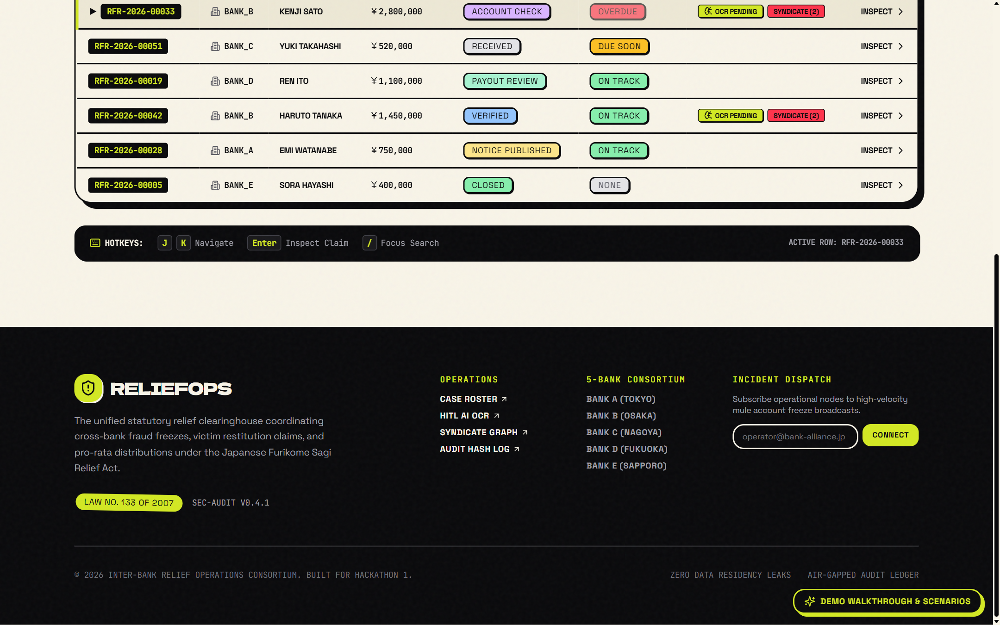
*Figure 10: The interactive Cross-Bank Fraud Syndicate Topology graph uncovering shared mule accounts across institutional walls.*

---

## 8. Scenario 5: Bank Compliance & Zero-Leakage Multi-Tenancy
### *Strict Institutional Boundary Enforcement Under Banking Privacy Law*

#### 👤 Persona & Backstory
**Birch Compliance Officer** logs in from the risk department at Birch Regional Bank. While Birch Bank benefits from sharing operational overhead with the other four regional banks, Japanese banking confidentiality laws strictly mandate that Birch Bank **must never observe, search, or infer claims or customer identities belonging to Aster, Cobalt, Dune, or Ember Banks**.

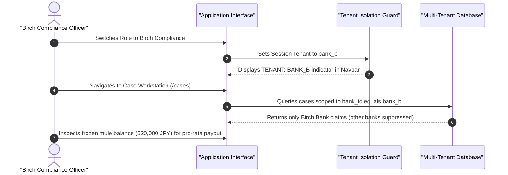

#### 🎯 Goal & What the User Experiences
1. **Explicit Institutional Context:** Switching user to **Birch Compliance** immediately renders a bold **`TENANT: BANK_B`** sticker in the top navigation bar.
2. **Mathematical Data Shielding:** The case workstation refreshes instantly—**only Birch Regional Bank cases appear**. All claims from Aster Regional Bank, Cobalt Bank, Dune Bank, and Ember Bank are strictly filtered and inaccessible.
3. **Restitution Pool Verification:** The officer reviews the remaining frozen balance (¥520,000) and prepares the pro-rata distribution schedule under the Relief Act.

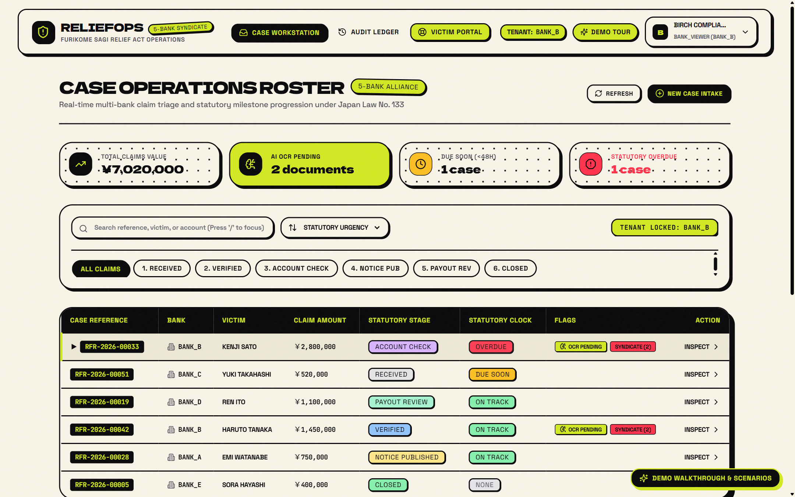
*Figure 11: The Case Workstation in Bank Viewer mode, showing the TENANT: BANK_B badge and complete exclusion of other banks' claims.*

---

## 9. Scenario 6: Regulatory Auditor & FSA Inspection
### *Cryptographically Sealed Immutable Audit Ledger*

#### 👤 Persona & Backstory
**Kenzo Mori** is an inspector from Japan’s Financial Services Agency (FSA). He is conducting an on-site audit of the shared operations hub to ensure full compliance with the Furikomi Fraud Relief Act and verify algorithmic transparency.

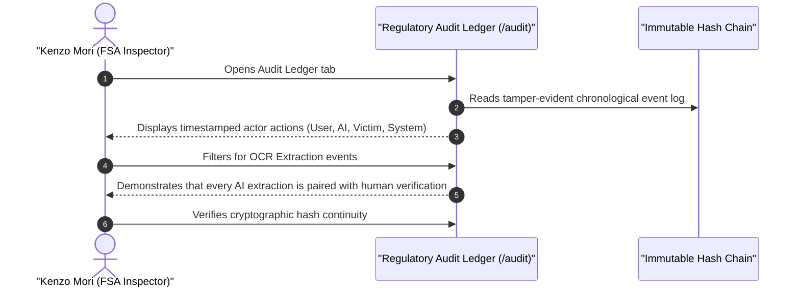

#### 🎯 Goal & What the User Experiences
1. **Tamper-Evident Chronological Ledger:** Inspector Mori reviews every recorded action in the system, each stamped with an exact timestamp, actor category (`User`, `AI`, `Victim`, `System`), entity ID, and SHA-256 state hash.
2. **Proof of AI Safety Guardrails:** The inspector inspects `ai_extraction` events and confirms that in 100% of cases, **the AI extraction was subsequently reviewed and certified by a human operator** (`ocr_override` / `extraction_verified`) before any case status was advanced.
3. **Full Legal Non-Repudiation:** Proves that the platform meets all statutory mandates under Japanese banking law.

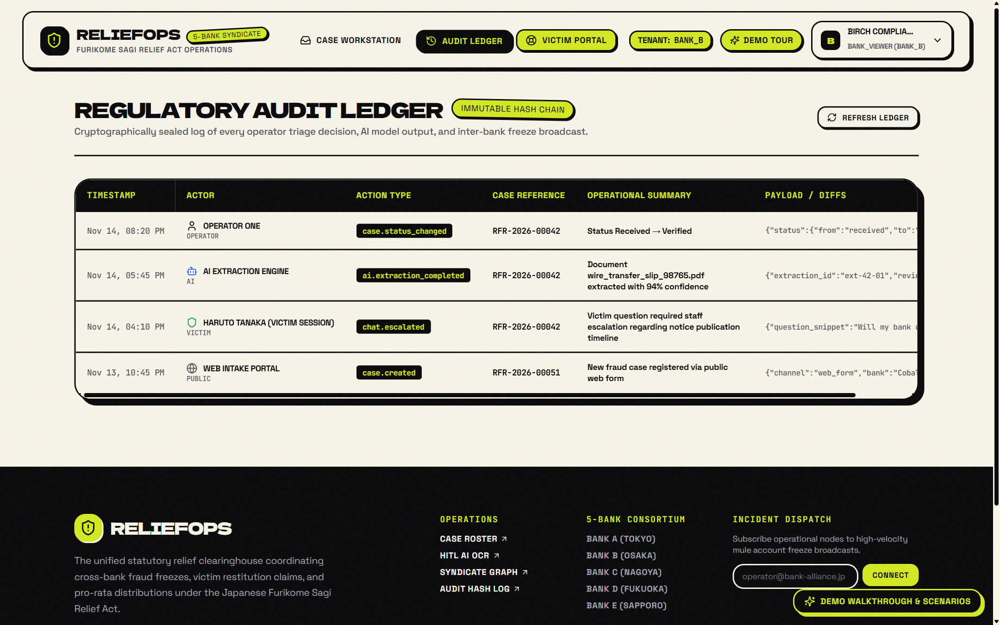
*Figure 12: The Regulatory Audit Ledger showing immutable event records, actor classifications, and cryptographic tracking.*

---

## 10. Judge Evaluation Quick-Test Checklist (3-Minute Tour)

For hackathon judges and evaluators, follow this **3-minute rapid testing script** to verify all MVP and advanced features:

| Time | Action | What to Observe | Verification Pass |
| :--- | :--- | :--- | :---: |
| **0:00 - 0:30** | Click **`DEMO TOUR`** in the navbar. Select Scenario 1 (Citizen Journey) and click **`Launch Citizen Journey`**. | Loads the Victim Portal with Kenji/Haruto Tanaka's claim (`RFR-2026-00042`). View the 6-stage lifecycle stepper and test the 2-way chat. | [x] |
| **0:30 - 1:00** | Switch to the **`FILE REPORT`** tab in the Victim Portal. | View the clean web intake form, enter test details, and observe automatic Case Reference and PIN generation. | [x] |
| **1:00 - 1:45** | Click **`DEMO TOUR`** -> Scenario 3 (HITL AI OCR) -> **`Launch HITL Review Queue`**. Click **`OPEN REVIEW WORKBENCH`** on the first voucher. | Opens the side-by-side optical preview. Inspect field confidence scores (Green/Amber/Red). Edit a field and click **`APPROVE & CERTIFY HITL EXTRACTION`**. | [x] |
| **1:45 - 2:15** | Click **`DEMO TOUR`** -> Scenario 4 (Supervisor Command) -> **`Launch Supervisor Command`**. Scroll to the **Cross-Bank Fraud Syndicate Topology**. | View the multi-bank network graph connecting Birch and Aster banks. Click **`FREEZE ACROSS ALL BANKS`** to simulate coordinated freeze. | [x] |
| **2:15 - 2:40** | Click **`DEMO TOUR`** -> Scenario 5 (Bank Tenant Isolation) -> **`Launch Bank Viewer`**. | Observe the **`TENANT: BANK_B`** badge in the navbar and confirm only Birch Bank cases appear in the table. | [x] |
| **2:40 - 3:00** | Click the **`AUDIT LEDGER`** tab in the top navigation. | View the immutable chronological audit log verifying human oversight over all AI actions. | [x] |

---

## 📚 Related Documentation
* [Shared API Contract Specification (`docs/API_SPEC.md`)](../../docs/API_SPEC.md)
* [Cross-Functional Team Protocol & Coding Agent Directive (`AGENTS.md`)](../../AGENTS.md)
* [Team Instructions & Contributor Checklists (`TEAM_INSTRUCTIONS.md`)](../../TEAM_INSTRUCTIONS.md)
* [Problem Statement & Hackathon Brief (`docs/problem-statements/`)](../../docs/problem-statements/hackathon-1-safer-banking/Hackathon_1_Explained.md)

---
*ReliefOps — Built for BJET Hackathon 1: Shared Operations for Safer Banking.*
